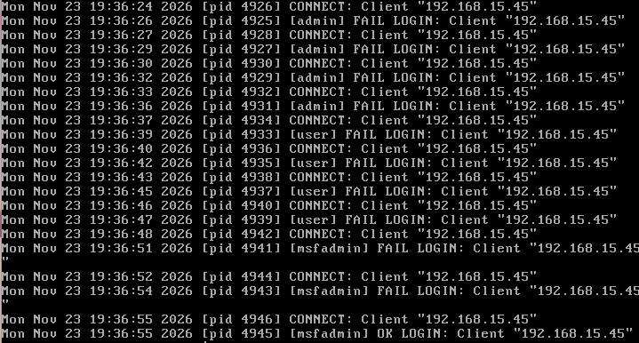

```bash
sudo tail -n 20 /var/log/vsftpd.log
```
Observa-se claramente o padrão clássico de um ataque automatizado de força bruta originado a partir do IP do Kali Linux (`192.168.15.45`):
* Múltiplas conexões (`CONNECT`) por segundo;
* Tentativas falhadas sequenciais (`FAIL LOGIN`) com os usuários `admin`, `user` e `msfadmin`;
* A tentativa bem-sucedida final (`OK LOGIN`) com o usuário `msfadmin`.

*Figura 6: Registro de auditoria do vsftpd no Metasploitable comprovando as tentativas em massa e o login obtido.*
---
## Medidas Defensivas e Contramedidas
A compreensão do vetor de ataque permite estruturar estratégias de defesa em profundidade:
1. **Políticas de Bloqueio de Contas (Account Lockout):**
   * Configuração de limite máximo de tentativas consecutivas incorretas (ex.: bloqueio temporário após 3 a 5 falhas).
2. **Implementação de Fail2ban ou IPS:**
   * Utilização de ferramentas como o `fail2ban` para analisar logs de autenticação e criar regras temporárias de firewall (`iptables`/`nftables`) bloqueando o IP de origem.
3. **Autenticação Baseada em Chaves (SSH):**
   * Desativar a autenticação por senha (`PasswordAuthentication no` no `sshd_config`) e exigir chaves criptográficas assimétricas (ed25519 ou RSA).
4. **Autenticação Multifator (MFA/2FA):**
   * Exigir uma segunda camada de validação temporal (TOTP), inviabilizando o acesso mesmo se a senha for descoberta.
5. **Políticas de Complexidade e Senhas Fortes:**
   * Obrigatoriedade de senhas longas (passphrases) para inviabilizar dicionários básicos e ataques de tamanho reduzido.
---
## Conclusão
O laboratório evidenciou como serviços com autenticação fraca e exposta sem mitigação de taxa de requisições (*rate limiting*) são vulneráveis a ataques automatizados. A prática reforça que a proteção de qualquer serviço exposto exige defesas em camadas, monitoramento constante de logs e restrição de acesso por senhas puras.
